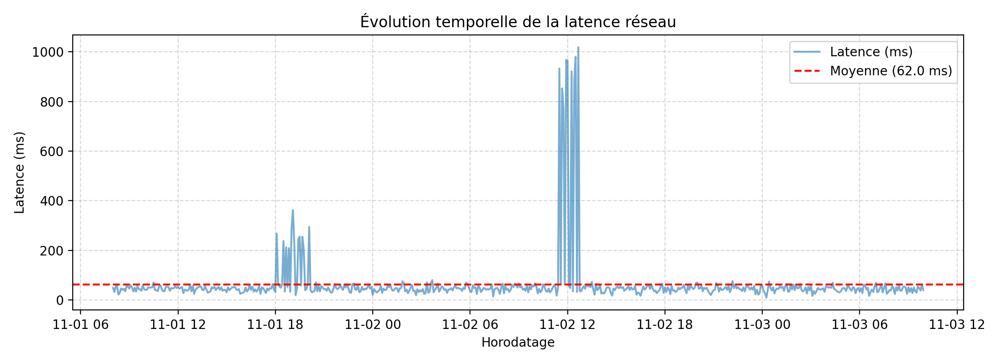
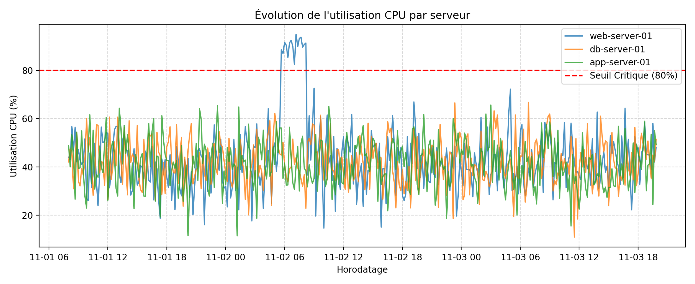
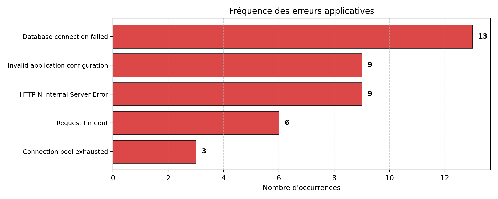

# 📊 Livrable 1 : Rapport d'Analyse et de Supervision de l'Infrastructure DemoTech
**Module :** CI GI - Intelligence Artificielle Générative & Modèles de Langues  
**Enseignant :** Pr. C. AZROUMAHLI  
**Contexte :** Plateforme AIOps - Étape 1 : Préparation & Analyse Exploratoire  

---

## 1. Synthèse Globale des Données Analysées

| Source de données | Volume | Doublons | Valeurs manquantes | État |
| :--- | :--- | :--- | :--- | :--- |
| `network_logs.csv` | 600 lignes | 0 | 0 | Conforme |
| `security_logs.csv` | 420 lignes | 0 | 0 | Conforme |
| `system_metrics.csv` | 1080 lignes | 0 | 0 | Conforme |
| `application_logs.txt` | 500 lignes | 0 | 0 | Conforme |
| `infrastructure_config.json` | 7 sections | - | - | Conforme |

---

## 2. Analyse des Données Réseau (`network_logs.csv`)

### Statistiques principales :
- **Total des communications :** 600
- **Répartition des protocoles :** TCP : 454 (75.67%) | UDP : 146 (24.33%)
- **Latence moyenne :** 62.03 ms (Pic maximal : 1018.50 ms)
- **Taux d'échec global :** 1.50% (9 requêtes en échec)
- **Ports les plus sollicités :**
  - Port 443 : 156 requêtes
  - Port 5432 : 156 requêtes
  - Port 53 : 146 requêtes
  - Port 80 : 142 requêtes

### Visualisation de la latence réseau :

### Anomalies réseau observées :
1. **Pic critique de latence (> 1000 ms)** le **02 novembre vers 12h00**, coïncidant avec l'intégralité des 9 échecs réseau (`FAILED`).
2. Dégradations de performance temporaires (`SLOW`, latence ~300 ms) constatées le **01 novembre entre 18h et 20h**.

---

## 3. Analyse des Événements de Sécurité (`security_logs.csv`)

### Statistiques principales :
- **Authentifications réussies :** 371
- **Authentifications échouées :** 49
- **Répartition par criticité :**
  - INFO : 371 (88.3%)
  - LOW : 33 (7.9%)
  - HIGH : 13 (3.1%)
  - MEDIUM : 3 (0.7%)

### Anomalies de sécurité détectées :
- **Adresses IP cumulant plusieurs échecs sur la période** (le cumul seul ne prouve pas une attaque : voir l'analyse temporelle ci-dessous) :
  - IP `192.168.1.51` : 14 échecs
  - IP `203.0.113.77` : 13 échecs
  - IP `10.0.0.40` : 9 échecs
  - IP `172.16.0.12` : 9 échecs
  - IP `192.168.1.50` : 4 échecs
- **Comptes les plus touchés :** `admin` (14 échecs), `app_user` (13 échecs).
- **Analyse temporelle :** les échecs de `203.0.113.77` (13, tous sur `admin`, sévérité HIGH) sont concentrés entre le 02/11 à 05:00 et 06:24, soit une rafale typique de force brute. Les échecs des autres IP (4 à 14) sont répartis sur 2 à 3 jours, de sévérité LOW pour l'essentiel : erreurs de saisie ou d'accès ponctuelles, sans caractère d'attaque établi.

---

## 4. Analyse des Ressources Système (`system_metrics.csv`)

### Métriques moyennes par serveur :
- **CPU moyen :**
  - `app-server-01` : 41.41%
  - `db-server-01` : 42.15%
  - `web-server-01` : 43.66%
- **Mémoire moyenne :**
  - `app-server-01` : 58.58%
  - `db-server-01` : 59.94%
  - `web-server-01` : 57.25%

### Visualisation de l'utilisation CPU :

### Dépassements de seuils critiques :
1. **Saturation CPU (> 80%) :** Observée sur `web-server-01` entre **2026-11-02 05:40:00** et **2026-11-02 08:10:00**, avec des pointes à 94.6%.
2. **Saturation Disque critique :** Le serveur `app-server-01` a atteint un taux d'occupation de **97.20%** le 2026-11-03 17:30:00.

---

## 5. Analyse des Journaux Applicatifs (`application_logs.txt`)

### Répartition des niveaux :
- **INFO** : 460 logs (92.0%)
- **ERROR** : 40 logs (8.0%)

Aucun événement `WARNING` n'existe dans ce jeu de données (uniquement INFO et ERROR).

### Erreurs regroupées par type (chiffres normalisés) :
- Database connection failed : 13
- Invalid application configuration : 9
- HTTP N Internal Server Error : 9
- Request timeout : 6
- Connection pool exhausted : 3

### Visualisation des erreurs applicatives récurrentes :

---

## 6. Synthèse des incidents observés (et limites de l'analyse)

Six épisodes se distinguent. Leur rapprochement est **temporel** ; aucun lien de cause à effet n'est démontré par ces seules statistiques.
1. **01/11 18:05–20:05** : 12 communications lentes (ports 80 et 443) et rafale de 19 erreurs applicatives (18:40–19:52). Aucun seuil système franchi.
2. **02/11 04:00–04:28** : rafale de 8 erreurs applicatives, sans autre signal concomitant.
3. **02/11 05:00–08:10** : tentatives de connexion sur `admin` depuis `203.0.113.77` (05:00–06:24) et saturation CPU de `web-server-01` (05:40–08:10). Les fenêtres se chevauchent, mais la saturation dure 1 h 46 de plus que les tentatives.
4. **02/11 11:30–12:40** : 9 échecs réseau sur le port 5432 (base de données), plus une erreur « Database connection failed » à 12:24. La saturation CPU s'était terminée plus de 3 h auparavant.
5. **02/11 22:20 – 03/11 00:50** : mémoire de `db-server-01` entre 90 et 97,3 % (seuil 85 %).
6. **03/11 15:00–19:50** : disque de `app-server-01` entre 92 et 97,2 % (seuil 90 %).

L'analyse croisée détaillée (chronologie, hypothèses, éléments à vérifier) figure dans `rapport_final.md`.

## 7. Réponses aux questions de l'étape 1

**Quelles informations indiquent qu'un service réseau a un problème de disponibilité ou de performance ?**
Disponibilité : communications au statut `FAILED` et taux d'échec par port (ici 9 échecs, tous sur le port 5432 / base de données). Performance : statut `SLOW`, latence supérieure au seuil de 150 ms, pics de latence (1018,5 ms) et durée de la dégradation. Le croisement par port et par fenêtre de temps distingue un service défaillant d'un incident diffus.

**Pourquoi une succession d'échecs d'authentification justifie-t-elle une investigation ?**
Un échec isolé est banal (faute de frappe). Une rafale depuis une même source sur un même compte, en peu de temps, est la signature d'une attaque par force brute ou par bourrage d'identifiants ; si elle est suivie d'un succès, le compte peut être compromis. Le contexte compte : compte privilégié visé, IP externe, criticité HIGH, heure inhabituelle.
